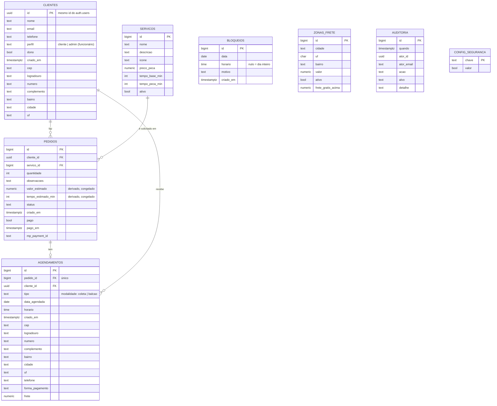

# Banco de dados do SpinLav

Colunas e tipos conferidos no Schema Visualizer do Supabase.

## DER

`BLOQUEIOS`, `ZONAS_FRETE`, `AUDITORIA` e `CONFIG_SEGURANCA` são tabelas de apoio e não têm chave estrangeira pras outras.

## Perguntas que podem cair

**Um pedido pode ter mais de um serviço?** Não. Cada pedido tem um serviço (`pedidos.servico_id`) e uma quantidade de peças. Se o cliente quer dois tipos de lavagem, faz dois pedidos. Por isso não existe a tabela `Servico_Pedido`. O motivo é que preço e tempo são calculados por tipo de lavagem, e um pedido misturado teria durações e status diferentes. Se um dia precisar, dá pra criar `pedido_itens(pedido_id, servico_id, quantidade)` e mover `servico_id` e `quantidade` pra lá.

**Qual a diferença entre serviço, pedido e agendamento?** Serviço é o catálogo (tipo de lavagem). Pedido é a solicitação do cliente (serviço + peças). Agendamento é a data, o horário e a modalidade do pedido.

**Como a duração é calculada?** `tempo_estimado_min = servicos.tempo_base_min + pedidos.quantidade × servicos.tempo_peca_min`, por um gatilho no banco.

**O que impede dois clientes de pegarem o mesmo horário?** O banco limita 3 pedidos por horário, respeita os bloqueios e os domingos, e a checagem acontece no insert. O site só mostra o resultado da função `horarios_lotados`.

## Normalização

**1FN.** Os campos são atômicos. O endereço é separado em CEP, logradouro, número, complemento, bairro, cidade e UF. Não tem lista dentro de coluna.

**2FN.** Todas as tabelas têm chave primária simples (`id`), então não existe dependência parcial.

**3FN.**
- `pedidos` guarda só o `servico_id`. Nome, preço e tempos ficam em `servicos`.
- `tempo_estimado_min` e `valor_estimado` em `pedidos` são derivados (dependem de `servico_id` e `quantidade`). Deixei assim de propósito: congelam o preço e o tempo da hora do pedido, então mudar o preço do serviço depois não altera pedido antigo. O gatilho preenche, ninguém digita.
- `pago`, `pago_em` e `mp_payment_id` em `pedidos` são do pagamento online, que veio depois.
- `agendamentos.cliente_id` dá pra descobrir por `pedido_id` > `pedidos.cliente_id`. Mantive pra simplificar as regras de segurança por linha (RLS). Se pedirem 3FN estrita, tira a coluna e a política passa a consultar `pedidos`.
- Endereço e telefone aparecem em `clientes` e em `agendamentos`. Em `clientes` fica o último usado (pra preencher o formulário). Em `agendamentos` fica o endereço daquela coleta, que não pode mudar se o cliente se mudar depois. São informações diferentes, não é repetição.
- `agendamentos.frete` também fica congelado na hora do agendamento, pelo mesmo motivo do valor do pedido.
