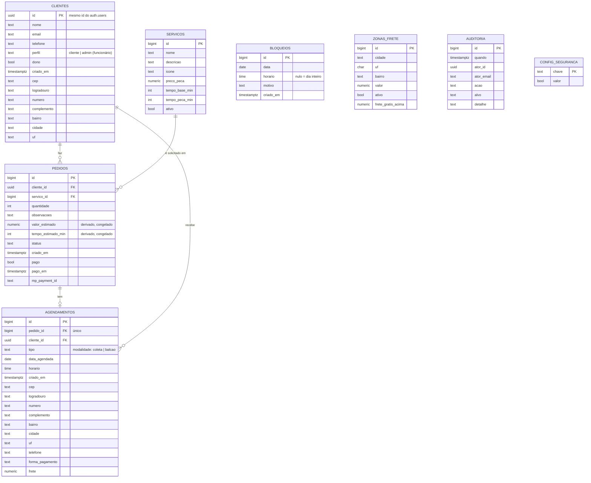

# SpinLav — Banco de dados (MER/DER e normalização)

> Colunas e tipos conferidos no **Schema Visualizer** do Supabase do projeto (Database → Schema Visualizer).

## DER (notação Mermaid — o GitHub desenha automaticamente)

`BLOQUEIOS`, `ZONAS_FRETE`, `AUDITORIA` e `CONFIG_SEGURANCA` são tabelas de apoio, sem chave estrangeira para as demais.

## Respostas às perguntas do professor

**Um pedido pode ter mais de um serviço?** Não. Cada pedido tem exatamente um serviço (`pedidos.servico_id`) e uma quantidade de peças. Se o cliente quer dois tipos de lavagem, faz dois pedidos. Por isso **não existe** a tabela intermediária `Servico_Pedido`. Justificativa: a lavanderia calcula tempo e preço por tipo de lavagem, e um pedido com tipos diferentes teria durações e status diferentes. (Se a lavanderia quiser mais de um serviço por pedido no futuro, basta criar `pedido_itens(pedido_id, servico_id, quantidade)` e mover `servico_id`/`quantidade` para lá.)

**Diferença entre serviço, pedido e agendamento.** Serviço = catálogo (tipo de lavagem). Pedido = solicitação do cliente (serviço + peças). Agendamento = data, horário e modalidade do pedido.

**Como a duração é determinada?** `tempo_estimado_min = servicos.tempo_base_min + pedidos.quantidade × servicos.tempo_peca_min`, calculado por gatilho no banco.

**O que impede dois clientes de reservarem horários incompatíveis?** O banco limita 3 pedidos por horário, respeita `bloqueios` e domingos, e a verificação acontece no insert (o site apenas mostra a consulta feita pela função `horarios_lotados`).

## Normalização

**1FN — atributos atômicos.** Endereço está separado em CEP, logradouro, número, complemento, bairro, cidade e UF; telefone e e-mail são campos únicos; não há listas dentro de colunas. ✔

**2FN — dependência da chave inteira.** Todas as tabelas têm chave primária simples (`id`), então não existe dependência parcial. ✔

**3FN — sem dependências transitivas.**
- `pedidos` guarda só `servico_id`; nome, preço e tempos ficam em `servicos`. ✔
- **`tempo_estimado_min` e `valor_estimado` em `pedidos`** são *atributos derivados* (dependem de `servico_id` e `quantidade`). Mantê-los é uma **desnormalização consciente**: congelam o preço e o tempo do momento do pedido, para que alterar o preço do serviço depois não mude pedidos antigos (histórico financeiro). São preenchidos pelo gatilho, nunca digitados.
- **Pagamento online:** as colunas `pago`, `pago_em` e `mp_payment_id` de `pedidos` existem para o pagamento online (evolução do projeto).
- **`agendamentos.cliente_id`** é determinável por `pedido_id → pedidos.cliente_id`. Mantido de propósito para simplificar as regras de segurança por linha (RLS) e consultas por cliente, sempre preenchido junto com o pedido do mesmo cliente. Se a banca exigir 3FN estrita, remove-se a coluna e a política passa a consultar `pedidos`.
- **Endereço e telefone em `clientes` e em `agendamentos`**: em `clientes` ficam o último endereço/telefone usado (para preencher o formulário); em `agendamentos` ficam o **endereço da coleta daquele dia**, que pode ser diferente e não pode mudar retroativamente se o cliente se mudar. São fatos diferentes, não redundância.
- `agendamentos.frete` também é congelado no momento do agendamento, pelo mesmo motivo do valor do pedido.
